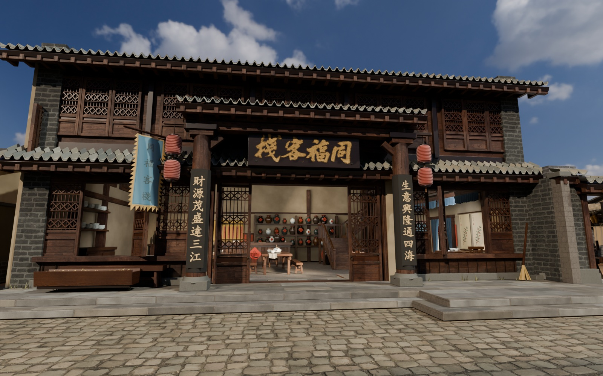
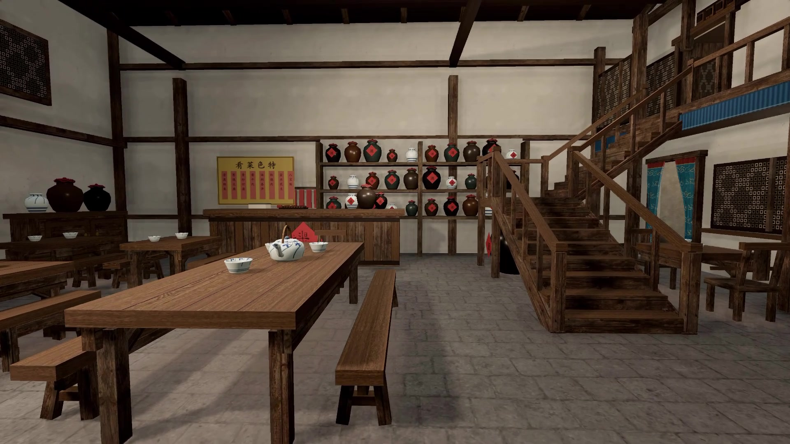
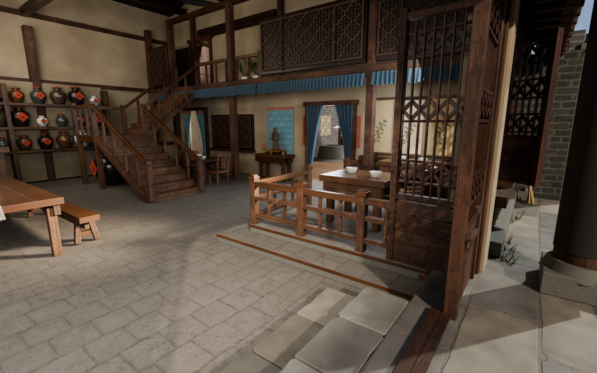
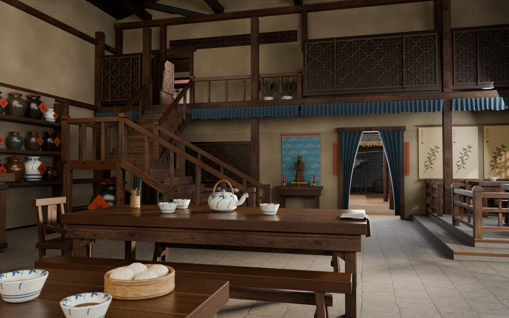
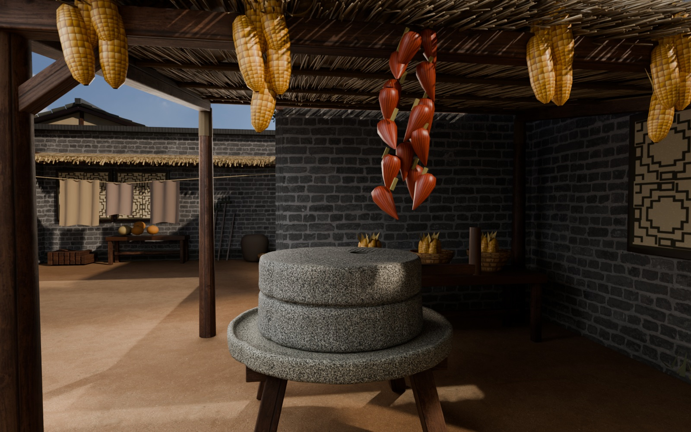

# 同福客栈 ·《武林外传》3D 漫游

**魔搭国内漫游**　[进入同福客栈 · Three.js 轻量版](https://aimtmtmt-tongfu-inn-3d.ms.show/index.html)　｜　[进入同福客栈 · Blender 版](https://aimtmtmt-tongfu-inn-3d.ms.show/blender.html)

**Vercel 在线漫游**　[进入同福客栈 · Three.js 轻量版](https://tongfu-inn-3d.vercel.app/)　｜　[进入同福客栈 · Blender 版](https://tongfu-inn-3d.vercel.app/blender/)

**GitHub Pages 备用入口**　[进入同福客栈 · Three.js 轻量版](https://crazy-mt.github.io/tongfu-inn-3d/)　｜　[进入同福客栈 · Blender 版](https://crazy-mt.github.io/tongfu-inn-3d/blender/)

从七侠镇的街上跨进客栈，门槛后还要下两级石阶，才到大家吃饭的那张长桌。你可以走过去看看秀才的算盘，顺木楼梯去佟湘玉的房间，或穿过蓝布帘，到后院找大嘴。

[Three.js 单文件](./同福客栈.html) · [Blender 单文件](./同福客栈·Blender离线漫游.html) · [整包下载 ZIP](https://github.com/Crazy-MT/tongfu-inn-3d/archive/refs/heads/main.zip) · [观看《茉莉花》抒情版](https://raw.githubusercontent.com/Crazy-MT/tongfu-inn-3d/main/videos/同福客栈·茉莉花抒情版.mp4)

## 打开漫游

下载 ZIP 并解压，或在所选 HTML 的 GitHub 文件页点击 **Download raw file**。双击 HTML，用支持 WebGL 的浏览器打开。两个版本都把运行所需的脚本、模型和贴图放进了单个文件，可以断网游览。

| 文件 | 适合看什么 |
| --- | --- |
| [Three.js 版](./同福客栈.html) | 约 2.7 MiB。直接用 Three.js 搭建的客栈，适合先走一遍看布局。 |
| [Blender 离线漫游版](./同福客栈·Blender离线漫游.html) | 约 33 MiB。将 Blender 场景的几何、材质和烘焙光照带入浏览器，可以近看木构、砖石与门帘。 |

**电脑**用 WASD 或方向键行走，拖动画面转头，按住 Shift 快走。**触屏**用左侧摇杆行走，拖动画面转头。点击左下角的地名可以直接换到关公供位、临窗堂座、二楼回廊等机位。按 H 可隐藏界面。

## 从门前走一圈

1. **进门。** 跨过门槛，往下走两级宽石阶。右边临窗的堂座又比大堂高两级，木栏朝堂内留了入口，两张桌子之间可以走人。
2. **到长桌和账台。** 大门正对秀才的柜台。绕到长桌另一侧，转身面向关公供位，就能看到剧中熟悉的构图。长桌在眼前，折梯在左，通院的蓝帘略偏右。柜台端头与楼梯之间留着过道，大酒坛收在转角平台下。
3. **上楼或去后院。** 楼梯中途拐弯，平台上可以回望大堂，也可以进佟湘玉的房间。回到一楼面对关公，左侧花帘通厨房，右侧蓝帘通后院。进院右手是粮棚和石磨，再往里是郭芙蓉与莫小贝的房间，对面住着李大嘴和吕秀才。
4. **从街上找另一条路。** 站在街上面对正门，向左转就正对告示墙，走到墙前再右转进小巷。正门右侧的通道可以直接进后院。

## 三支漫游短片

三支片子均为 32 秒，带中文字幕轨。片尾使用第一集对白「二十年快得很，弹指一挥间。」

| 短片 | 画面与声音 |
| --- | --- |
| [二十年快得很](videos/同福客栈·二十年快得很.mp4) | 1920 × 1080，30 fps。镜头从街面进入 Three.js 大堂，用《好久不见》的器乐引子带出回忆。 |
| [茉莉花抒情版](videos/同福客栈·茉莉花抒情版.mp4) | 1920 × 1080，30 fps。沿用上一支的镜头和对白，将配乐换成《茉莉花》钢琴变奏。 |
| [进门听茉莉花（Blender 版）](videos/同福客栈·进门听茉莉花（Blender版）.mp4) | 1280 × 720，24 fps。从 Blender 场景的临街门楼起步，下阶后在长桌旁停下，缓缓环顾大堂。沿用抒情版混音。 |

## 制作提示词（整理版）

这些提示词把几轮对话里反复校正的方位合并在一起。室外的左右以「站在街上，面对客栈正门」为准，进门后的左右以行进方向为准。

**1. 搭一座能走进去的同福客栈**

> 只用 Three.js，做成单个 HTML，按《武林外传》剧中场景重建同福客栈。我要能从大门外走进大堂，能上楼梯，也能去后院。找原剧资料核对空间关系。

**2. 改门前的巷口和门内高差**

> 站在街上正对大门，左转后应该正面看见告示墙，走到墙前右转才是小巷。正门右边要能直接走到后院。抬高大门门槛，门外走两级台阶上去；进门后要再下两级才到大堂。进门右手的地方做宽一些，两级地台上围一圈木栏杆。

**3. 补齐大堂、卧房和后院**

> 大堂里补几张饭桌，还要有关公供位。柜台和楼梯之间给人留出能走过去的空当。大堂要有单独通厨房的门，去后院的方向也要对。进后院右手先是棚子，棚下挂着农作物，放着磨盘；再往里走才到莫小贝和郭芙蓉的房间。李大嘴和吕秀才的房间、楼上佟湘玉的房间也要能走进去。

**4. 拍一段进门的长镜头**

> 从大门走进去，到大堂后环顾四周。背景音乐用《武林外传》里的音乐，声音用佟湘玉的台词「二十年快得很，弹指一挥间」。

> 把背景音乐改成剧里那段抒情的音乐。

成片把最后一句落实为《茉莉花》的慢板钢琴变奏。Three.js 的两个版本使用同一条镜头；Blender 版沿用这段混音，重新拍了一遍进门路线。

## 参考

场景方位参考了原剧画面、拍摄地照片和观众绘制的平面图。房间尺度和镜头外的连接按漫游需要估算。[央视网《武林外传》第一集](https://tv.cctv.com/2014/07/27/VIDE1406399770522952.shtml) · [拍摄地与大堂照片](https://www.sohu.com/a/274779219_100154148) · [同福客栈布局考据](https://www.bilibili.com/opus/646022266046382117)

抒情版的钢琴选段来自公开曲集收录的《茉莉花变奏曲》。[曲集第 7 轨](https://www.bilibili.com/video/BV1gfnfecEJe/?p=7)

两个 HTML 均内嵌 Three.js r160。[Three.js 许可证](./THREE-LICENSE.txt) · [部分材质来源：Poly Haven](https://polyhaven.com/textures)
